<picture>
  <source media="(prefers-color-scheme: dark)" srcset="assets/masthead-dark.svg">
  
</picture>

I'm Jackson Ly, an AI systems engineer in Germany and lead engineer for [Registercheck](https://www.registercheck.de) at Openlaw, a YC-backed startup (F24). Most of my engineering now runs through AI coding agents, many of them at once, so a lot of my work is what sits around them: clear briefs, checks that don't take an agent's word for "done", and knowing which work shipped.

## Agent Clinic: help with Claude Code and Codex

Agents that stop halfway, loop for hours or say "done" when they aren't? Agent Clinic is my hands-on help for engineers, teams and founders: we fix the setup in your repo, so the work finishes and you can check it. [See how it works](https://jacksonly.xyz/help)

## What I'm building

## Lately on GitHub

<picture>
  <source media="(prefers-color-scheme: dark)" srcset="assets/stats-dark.svg">
  
</picture>

## Writing

I write about running many agents at once and checking what they did. The latest:

<!-- RECENT-POSTS:START -->
- [225 billion Claude Code tokens in 30 days: what the number actually measures](https://jacksonly.xyz/blog/225-billion-claude-code-tokens-in-30-days) · 18 Oct 2026
- [Test the second access path before you call a metric unreadable](https://jacksonly.xyz/blog/test-the-second-access-path-before-you-call-a-metric-unreadable) · 15 Aug 2026
- [Refreshing a token I did not own logged our account out](https://jacksonly.xyz/blog/refreshing-a-token-i-did-not-own-logged-our-account-out) · 11 Aug 2026
- [A 200 response is not a page, and your policy check is grepping an empty shell](https://jacksonly.xyz/blog/a-200-response-is-not-a-page-and-your-policy-check-is-grepping-an-empty-shell) · 9 Aug 2026
<!-- RECENT-POSTS:END -->

[All posts on jacksonly.xyz](https://jacksonly.xyz/blog)

## Small tools

- [Claudometer](https://github.com/jacksnxly/Claudometer) is a macOS menu-bar app that shows your Claude Code usage against the 5-hour and 7-day limits.
- [keryx](https://github.com/jacksnxly/keryx) writes release notes from pull requests and conventional commits (Rust CLI).
- [claude-issue-toolkit](https://github.com/jacksnxly/claude-issue-toolkit) is a Claude Code plugin that takes an issue from creation through validation to a fix, tracked in Linear or in local Markdown files.

## Stack

Mostly TypeScript and Python, with Next.js, SvelteKit, FastAPI and SQLite. Rust for command-line tools, SwiftUI and Kotlin for native apps.

## Elsewhere

[Book a call](https://cal.com/lyjackson/15min) · [Website](https://jacksonly.xyz) · [LinkedIn](https://www.linkedin.com/in/jackson-ly) · [X](https://x.com/jacksnxly) · [DEV](https://dev.to/jacksonxly) · [Medium](https://medium.com/@lyjackson) · [YouTube](https://www.youtube.com/@jacksonly)
